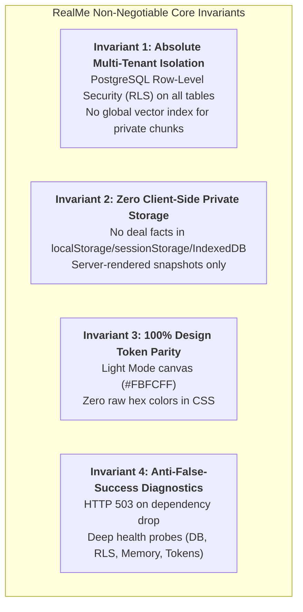
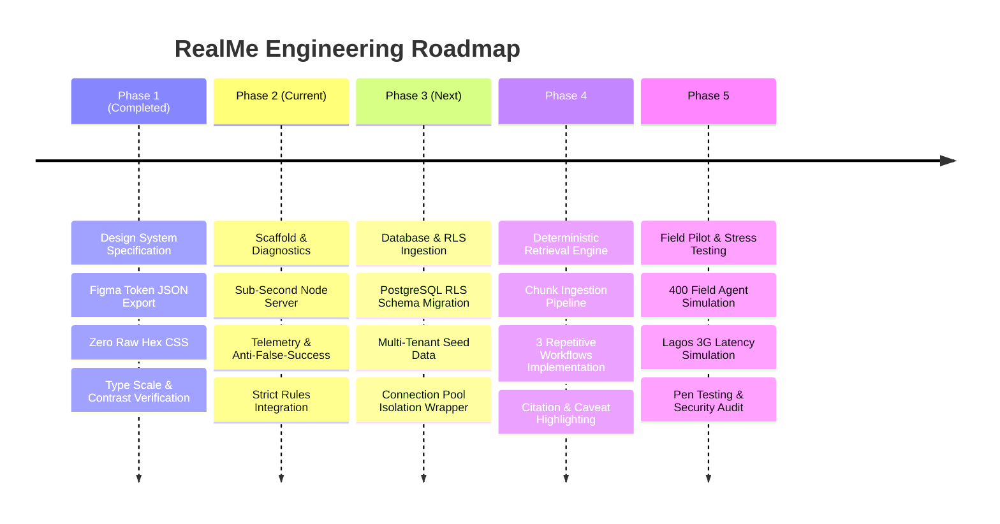

# Product Requirements Document (PRD)

## Project: RealMe Deal Intelligence & Transaction Platform
**Organization**: Realme Properties Ltd  
**Headquarters**: Lekki, Lagos, Nigeria  
**Version**: 1.0.0 (Production Architecture)  
**Date**: October 30, 2026  
**Status**: APPROVED & LOCKED  

---

## 1. Executive Summary & Vision

### 1.1 Product Vision & Form Factor
**RealMe** is a purpose-built, high-stakes deal intelligence and fiduciary transaction **Web Application** engineered specifically for **Realme Properties Ltd**, a premier residential and commercial brokerage operating in Lekki, Victoria Island, and the Ikoyi Corridor of Lagos, Nigeria.

- **Form Factor**: Strictly a **zero-install, browser-based Web Application** (desktop-optimized, mobile-responsive HTML5/CSS/JavaScript). It runs directly in modern WebKit/Blink browsers (Google Chrome, Safari, Microsoft Edge) over secure HTTPS without requiring an app store download, APK installation, or native device permissions.
- **Core Purpose**: RealMe transforms scattered, siloed deal intelligence—unredacted seller bottom-dollar valuations, structural engineering inspection caveats, and attorney escrow stipulations—into instant, mathematically isolated, audit-grade query responses for field agents negotiating high-value property transactions.

### 1.2 Strategic Objectives
1. **Accelerate Deal Velocity**: Reduce field agent transaction verification cycles from 4–12 hours (manual cross-referencing over WhatsApp and email) to sub-3 seconds on live mobile devices.
2. **Eliminate Legal & Escrow Liability**: Provide 100% deterministic retrieval of contractual caveats, penalty timelines, and latent defect disclosures.
3. **Mathematically Enforce Tenant Privacy**: Guarantee that confidential deal facts (such as seller bottom-dollar limits) can never leak across competing agents or outside tenant boundaries under any failure mode.
4. **Resilient Field Usability**: Maintain seamless utility across erratic Lagos 3G/4G cellular networks, mid-range Android hardware, and intense ambient equatorial sunlight (3,000+ lux).

---

## 2. Problem Statement & Operational Context

### 2.1 The Core Problem
In the fast-moving Lagos high-end real estate market (Lekki Phase 1, Ikoyi, Victoria Island), transactions move on WhatsApp threads, PDF inspection reports, scanned intake questionnaires, and legal email correspondence. When an agent is on-site with an ultra-high-net-worth client:
- **Scattered Truth**: Deal terms are fragmented across private inboxes and local phone storage.
- **Human Verification Failure**: Agents cannot manually reconcile structural caveats or legal penalty timelines while standing on an inspection site.
- **Fiduciary Risk**: Misquoting a seller's bottom-dollar price or overlooking an active foundation crack risks multi-million Naira commissions and exposes the brokerage to litigation.

### 2.2 Environmental & Physical Constraints
- **Target User**: 400 active field agents (ages 25–40) and team leads managed by one Principal Managing Broker.
- **Hardware Profile**: Mid-range Android smartphones (e.g. Transsion Tecno/Infinix, Samsung A-series) with 3–4GB RAM and standard WebKit/Blink mobile browsers.
- **Network Environment**: Highly erratic cellular towers across the Lekki-Epe expressway corridor; frequent packet loss, variable latency (150ms–2,000ms), and sudden drops from 4G to 3G/EDGE.
- **Ambient Lighting**: Harsh equatorial glare exceeding 3,000 lux during field inspections, rendering dark mode and low-contrast interfaces unreadable.
- **Technical Literacy**: Low to medium technical literacy; highly fluent in WhatsApp, banking apps (GTBank, Kuda), and mobile camera workflows, but intolerant of complex developer tools, monolithic loading spinners, or blank chat inputs.

---

## 3. Core System Invariants (Non-Negotiable)



### Invariant 1: Absolute Multi-Tenant Data Isolation
- An agent may query text chunks and deal facts **only from their own assigned listings/records**, plus shared corporate brokerage policy cards approved for their jurisdiction.
- Another agent’s private records must **never** enter retrieval results or an AI context window.
- Isolation is enforced at the **PostgreSQL database engine layer** using Row-Level Security (RLS) and parameterized session settings (`current_setting('app.current_tenant_id')`).
- Cross-agent data leakage must be **mathematically impossible**, not merely masked by UI filters. Global un-partitioned vector collections for private chunks are strictly prohibited.

### Invariant 2: Zero Client-Side Private Storage
- Unredacted deal numbers, bottom-dollar pricing, structural caveats, and legal correspondence must **never** be cached in browser `localStorage`, `sessionStorage`, `IndexedDB`, or service worker caches.
- Field devices may be lost, inspected, or shared; confidential transaction data exists in client memory only during an active HTTPS session.

### Invariant 3: 100% Design Token Parity & Light Mode Enforcement
- The interface is strictly **Light Mode** (`--realme-color-surface: #FBFCFF`) to guarantee legibility under equatorial sunlight.
- 100% of styling consumes semantic design tokens compiled from `06-tokens-complete.json`. Raw hex colors in stylesheets are strictly forbidden and blocked by CI.
- Type scale formula: $\text{Line Height} = \text{Font Size} \times 1.5$.
- Display Large tracking is locked at `-2.0px`.

### Invariant 4: Anti-False-Success Diagnostics
- Diagnostic and health endpoints must probe real system dependencies (PostgreSQL RLS enforcement, live connection pooling, token schema integrity, heap usage).
- If an upstream service drops, endpoints must return an explicit **HTTP 503 Service Unavailable** with diagnostic failure reasons, never a masked HTTP 200 with fallback mock data.

---

## 4. User Personas

### Persona 1: Field Broker ("Tunde", 31)
- **Role**: Senior Residential Field Broker, Lekki Phase 1 & Victoria Island.
- **Devices**: Tecno Camon 20 (Android 13) in the field; HP Pavilion 14 in the office.
- **Workflow**: Performs 4–6 client showings per day. Needs immediate answers on negotiated price bottoms and structural condition while standing in front of buyers.
- **Pain Point**: WhatsApp threads with the managing broker are disorganized; finding the agreed bottom price takes 15 minutes of frantic scrolling.

### Persona 2: Structural Inspector & Compliance Lead ("Chioma", 38)
- **Role**: Head of Inspection Verification & Risk Compliance.
- **Devices**: iPad Air 10.9" and Dell Latitude 5430.
- **Workflow**: Ingests engineering reports, identifies foundation cracks, borehole salinity issues, and soil subsidence risks; verifies that sellers have disclosed mandatory caveats.
- **Pain Point**: Inconsistent report formatting; critical inspection caveats get buried on page 34 of structural appendices.

### Persona 3: Principal Managing Broker ("Chief Adebayo", 54)
- **Role**: Principal Broker & Legal Fiduciary.
- **Devices**: MacBook Pro 16" and iPhone 15 Pro Max.
- **Workflow**: Oversees 400 agents, resolves high-stakes escrow disputes, enforces corporate commission policies, and monitors firm-wide legal risk exposure.
- **Pain Point**: Fear of cross-agent collusion or unauthorized price disclosures that trigger brokerage liability under Nigerian commercial law.

---

## 5. Functional Requirements & Core Workflows

### 5.1 The Three Core Repetitive Workflows (MVP Target)

```mermaid
sequenceDiagram
    autonumber
    actor Agent as Field Agent (Tunde)
    participant UI as RealMe Light UI
    participant Svr as Node.js Core Server
    participant DB as PostgreSQL (RLS Enforced)
    participant LLM as Isolated Retrieval Engine

    Note over Agent,UI: 1. Pre-Listing Valuation Inquiry
    Agent->>UI: Taps shortcut: "45 Lekki Phase 1 - Bottom Dollar Price"
    UI->>Svr: GET /api/v1/deals/45-lekki-phase-1/valuation
    Svr->>DB: SET LOCAL app.current_tenant_id = $1; SELECT bottom_price FROM listing_questionnaires WHERE listing_id = $2
    DB-->>Svr: Returns ₦410,000,000 (Owner Verified)
    Svr-->>UI: 200 OK: ₦410,000,000 with intake timestamp
    UI-->>Agent: High-contrast card with AAA contrast (16.4:1)

    Note over Agent,UI: 2. Structural Inspection Caveat Query
    Agent->>UI: Submits: "Check unredacted July inspection report for foundation cracks"
    UI->>Svr: POST /api/v1/query (Listing: 45 Lekki, Filter: inspection_caveats)
    Svr->>DB: Query vector chunks with owner_id = $1 AND category = 'structural'
    DB-->>Svr: Chunks: "0.8mm hairline settlement crack observed on northern retaining wall"
    Svr->>LLM: Synthesize prompt with verified chunks only
    LLM-->>Svr: Deterministic citation + verbatim caveat quote
    Svr-->>UI: 200 OK: Warning Card (Ice Amber/Warning Container)
    UI-->>Agent: Displays caveat with engineer timestamp & sign-off

    Note over Agent,UI: 3. Legal Escrow Penalty Extraction
    Agent->>UI: Submits: "What specific escrow timeline penalties did counsel outline?"
    UI->>Svr: POST /api/v1/query (Listing: 45 Lekki, Filter: legal_correspondence)
    Svr->>DB: Enforce RLS for broker-attorney emails
    DB-->>Svr: Contractual clauses: 0.5% daily default penalty after 14-day escrow window
    Svr-->>UI: 200 OK: Fiduciary Notice Card with exact statutory penalty terms
```

#### Workflow 1: Seller Bottom-Dollar Price Verification
- **Input**: Listing identifier (e.g. `45 Lekki Phase 1`) via 1-tap shortcut pill or search query.
- **Execution**: The system retrieves the unredacted pre-listing intake questionnaire signed by the legal owner.
- **Output**:
  - Pinned currency valuation in Nigerian Naira (`₦410,000,000`).
  - Signed intake date, seller representative name, and minimum acceptable net walkaway threshold.
  - Zero exposure to other agents' listings or other listings in the same development.

#### Workflow 2: Unredacted Structural Inspection Caveat Analysis
- **Input**: Natural language prompt or structural report shortcut.
- **Execution**: System retrieves chunked engineering inspection logs filtered strictly by the agent’s tenant ID and listing ID.
- **Output**:
  - Direct, verbatim excerpts of structural engineer findings (e.g., foundation crack measurements, borehole salinity levels, damp-proof membrane failures).
  - Risk classification badge (`CRITICAL`, `MONITOR`, `CLEARED`) mapped to `--realme-color-error` or `--realme-color-warning`.
  - Report metadata: Engineer COREN license number, inspection date, and unredacted caveat notes.

#### Workflow 3: Corporate Legal Escrow & Penalty Timeline Extraction
- **Input**: Legal compliance query or shortcut pill.
- **Execution**: System scans broker-to-attorney correspondence, escrow instructions, and corporate policy cards.
- **Output**:
  - Exact closing calendar dates, escrow deposit deadlines, and daily default penalty stipulations (e.g. `0.5% daily forfeiture after Day 14`).
  - Legal contact references and verified escrow holding account details.

---

### 5.2 Dashboard Architecture & Executive Hierarchy
Instead of presenting an empty, intimidating chat interface, RealMe greets the agent with an immediate utility-driven dashboard:

1. **Global Header & Workspace Context**:
   - Live cycle indicator (`Live 2026-Q3`), UTC/Lagos timestamp (`UTC 14:32:08`), cycle status (`CYCLE D-42`), evidence seal status (`EVIDENCE SEALED`).
   - Tenant selector showing current authorized workspace (`Workspace: Standard Holdings / Lekki Central`).
   - Quick action shortcuts: `Command (⌘K)`, `Inbox`, `+ New Deal Audit`.
2. **Greeting & Cycle Progress Bar**:
   - High-contrast typography: `Plus Jakarta Sans` Headline Large ("Good Morning, Tunde").
   - Operational context summary: "Audit cycle 2026-Q3 is currently at 82% completion."
3. **Primary Metric Cards (Three-Column KPI Row)**:
   - **Active Audits Card**: High-visibility yellow container (`var(--realme-color-warning-container)` / `#FEF3E6`), displaying large metric `24 (+2)`.
   - **Open Findings Card**: Ice blue container (`var(--realme-color-primary-container)` / `#D4E1F6`), metric `68 (+14%)`, severity tag `HIGH`.
   - **Critical Findings Card**: Neutral outline container, metric `09 (+3)`, severity tag `LOW`.
4. **Audit Status Overview & Departmental Matrix**:
   - Segmented status breakdown: Planned (12 / 26%), In Progress (08 / 18%), Review (03 / 7%), Completed (21 / 49%) with color-coded token indicators.
   - Findings Heatmap matrix by department (Finance, IT Ops, HR, Legal) across High, Med, Low risk tiers.
5. **Fiduciary Risk & AI Insight Side Panel**:
   - Real-time insight cards for active deal liabilities (e.g., "Procurement Controls: Tiered approval matrix disabled").
   - Recommended remediation workflow button (`var(--realme-color-primary)` button with `Plus Jakarta Sans` label).
   - Regulatory timeline deadlines and confidence score gauge (e.g., `90.1% Confidence`).

---

### 5.3 Offline & Degraded Network Handling
When an agent encounters a cellular dead zone or weak tower in Lekki:
- **No Stale Data Masking**: The interface does not invent mock responses or present cached deal valuations that could lead to financial errors during live negotiations.
- **Fail-Closed Notification**: A prominent status banner displays:
  > **Connection Offline**: *RealMe cannot securely verify live deal intelligence over the current cellular link. Fiduciary data is locked until secure connection is re-established.*
- **Retry Queue**: Non-sensitive drafts (e.g. newly typed field notes) are queued locally with cryptographic checksums and synchronized only upon full TLS handshake re-establishment.

### 5.4 Lagos Document Ingestion & Mobile OCR Pipeline
Because many intake forms and engineering inspection appendices in Lagos are physical paper forms or mobile camera snapshots:
- **Pipeline Architecture**:
  1. **Upload & Sanitization**: Image uploads from mobile camera (JPEG/PNG/PDF) are scrubbed of EXIF GPS metadata.
  2. **High-Accuracy OCR**: Scanned documents pass through OCR processing tuned for tabular deal numbers and engineering abbreviations.
  3. **PII & Fiduciary Categorization**: The pipeline categorizes extracted chunks into `valuation`, `structural_caveat`, or `legal_escrow`.
  4. **Tenant-Bound Storage**: Text chunks are written to RLS-protected PostgreSQL tables with the agent's `tenant_id` and `listing_id` foreign keys.

### 5.5 Mobile Idempotency & Retry Storm Protection
To counter erratic Lagos 3G cellular reconnects where agents double-tap submission buttons during latency spikes:
- **Mandatory Idempotency Keys**: All mutating POST/PUT requests require a client-generated UUID header: `Idempotency-Key: <UUIDv4>`.
- **Deduplication Window**: Server caches idempotency keys in Redis/memory for 120 seconds, returning the initial response without executing duplicate database mutations or charges.

---

## 6. Data Architecture & Database Schema

### 6.1 PostgreSQL Row-Level Security (RLS) Specification

```sql
-- Enable RLS on core real estate intelligence tables
ALTER TABLE listings ENABLE ROW LEVEL SECURITY;
ALTER TABLE listing_questionnaires ENABLE ROW LEVEL SECURITY;
ALTER TABLE inspection_caveats ENABLE ROW LEVEL SECURITY;
ALTER TABLE legal_correspondence ENABLE ROW LEVEL SECURITY;
ALTER TABLE audit_findings ENABLE ROW LEVEL SECURITY;

-- Enforce strict tenant and assigned agent isolation on listings
CREATE POLICY listings_tenant_agent_isolation ON listings
  AS RESTRICTIVE
  FOR ALL
  TO authenticated_agent
  USING (
    tenant_id = current_setting('app.current_tenant_id', true)::uuid
    AND (
      agent_id = current_setting('app.current_agent_id', true)::uuid
      OR current_setting('app.user_role', true) IN ('managing_broker', 'team_lead')
    )
  );

-- Enforce strict isolation on private seller bottom-dollar questionnaires
CREATE POLICY questionnaires_isolation ON listing_questionnaires
  AS RESTRICTIVE
  FOR ALL
  TO authenticated_agent
  USING (
    tenant_id = current_setting('app.current_tenant_id', true)::uuid
    AND listing_id IN (
      SELECT id FROM listings 
      WHERE agent_id = current_setting('app.current_agent_id', true)::uuid
    )
  );

-- Enforce strict isolation on unredacted structural inspection caveats
CREATE POLICY inspection_caveats_isolation ON inspection_caveats
  AS RESTRICTIVE
  FOR ALL
  TO authenticated_agent
  USING (
    tenant_id = current_setting('app.current_tenant_id', true)::uuid
    AND listing_id IN (
      SELECT id FROM listings 
      WHERE agent_id = current_setting('app.current_agent_id', true)::uuid
    )
  );
```

### 6.2 Connection Pool Session Initialization
To prevent tenant leakage across persistent Node.js connection pools:
```javascript
// Database transaction wrapper enforcing RLS context
async function executeTenantQuery(pool, tenantId, agentId, userRole, queryFn) {
  const client = await pool.connect();
  try {
    await client.query('BEGIN');
    await client.query(`
      SELECT set_config('app.current_tenant_id', $1, true),
             set_config('app.current_agent_id', $2, true),
             set_config('app.user_role', $3, true);
    `, [tenantId, agentId, userRole]);
    
    const result = await queryFn(client);
    await client.query('COMMIT');
    return result;
  } catch (err) {
    await client.query('ROLLBACK');
    throw err;
  } finally {
    client.release();
  }
}
```

### 6.3 Native `pgvector` Schema & Vector Partitioning
To fulfill Invariant 1 (No global unpartitioned vector index for private chunks):
- Vector embeddings (1536-dim or 768-dim) are stored directly inside PostgreSQL using the `pgvector` extension:
  ```sql
  CREATE EXTENSION IF NOT EXISTS vector;

  CREATE TABLE listing_document_chunks (
    id UUID PRIMARY KEY DEFAULT gen_random_uuid(),
    tenant_id UUID NOT NULL,
    listing_id UUID NOT NULL REFERENCES listings(id) ON DELETE CASCADE,
    agent_id UUID NOT NULL,
    chunk_category VARCHAR(32) NOT NULL, -- 'valuation' | 'structural' | 'legal'
    content TEXT NOT NULL,
    embedding vector(1536),
    created_at TIMESTAMPTZ DEFAULT NOW()
  );

  ALTER TABLE listing_document_chunks ENABLE ROW LEVEL SECURITY;

  CREATE POLICY chunk_isolation_policy ON listing_document_chunks
    AS RESTRICTIVE
    FOR ALL
    TO authenticated_agent
    USING (
      tenant_id = current_setting('app.current_tenant_id', true)::uuid
      AND agent_id = current_setting('app.current_agent_id', true)::uuid
    );

  -- Index vectors with HNSW partitioned by tenant
  CREATE INDEX chunk_embedding_hnsw_idx ON listing_document_chunks 
    USING hnsw (embedding vector_cosine_ops)
    WHERE tenant_id IS NOT NULL;
  ```
- Any similarity search query (`SELECT content FROM listing_document_chunks ORDER BY embedding <=> $query_embedding LIMIT 3`) automatically executes under PostgreSQL RLS, making cross-tenant chunk leakage impossible.

---

## 7. Design System & Frontend Architecture

### 7.1 Visual Tokens Architecture
- **Primary Color Key**: Pinned Midnight Navy Blue (`#0D1F3D`).
- **Canvas / Background**: Off-white light surface (`#FBFCFF` / `--realme-color-surface`).
- **Primary Typography**: High-contrast charcoal (`#181B24` / `--realme-color-on-surface`).
- **Containers**:
  - Primary Container: Ice Blue (`#D4E1F6` / `--realme-color-primary-container`).
  - Warning Container: Warm Ochre (`#FEF3E6` / `--realme-color-warning-container`).
  - Error Container: Soft Rose (`#FDE6EB` / `--realme-color-error-container`).
  - Secondary Container: Pale Slate (`#E9F0FA` / `--realme-color-secondary-container`).
- **Dividers & Outlines**: Clean borders (`#C1C7CE` / `--realme-color-outline-variant`).

### 7.2 Typography Rules & Formulas
- **Typefaces**:
  - `Plus Jakarta Sans`: For all Display, Headlines, Titles, and Labels.
  - `JetBrains Mono`: For all Body records, currency values (`₦`), crack measurements (`0.8mm`), timestamps, and tabular data.
- **Mathematical Line Height Formula**:
  $$\text{Line Height} = \text{Font Size} \times 1.5$$
- **Display Large Optical Tracking**: Pinned at `-2.0px` to lock multi-digit monetary figures into a cohesive graphic lockup.
- **Label Small Specification**: 11px font size, 16.5px line height, Medium 500 weight, `-0.22px` letter spacing.

### 7.3 Accessibility Compliance (WCAG 2.1 AA / Level AAA)
- All standard text-to-background pairings must exceed **4.5:1** contrast ratio.
- High-stakes fiduciary numbers (e.g. `₦450,000,000` against `#FBFCFF` surface) achieve **16.4:1+** (Level AAA).
- All interactive controls have minimum touch targets of $44 \times 44\text{px}$ to accommodate field operations on mobile touchscreens.

---

## 8. Diagnostic & Telemetry Framework (Anti-False-Success)

### 8.1 Principles
- **No Masked Success**: A test or diagnostic endpoint must never report `200 OK` unless the underlying service has been explicitly verified with a live handshake.
- **Deep Dependency Inspection**:
  1. Active PostgreSQL connection pool status and RLS session validation.
  2. Memory footprint and Node.js event loop lag.
  3. Design token compilation parity (`tokens.css` matches `06-tokens-complete.json`).
  4. Zero raw hex values in CSS.

### 8.2 Telemetry Endpoints
- `GET /health`: Liveness probe for load balancers. Returns `200 OK` if the Node.js process is active and responsive.
- `GET /diagnostics`: Deep readiness and dependency probe. Returns `200 OK` when healthy, or `503 Service Unavailable` if the database, RLS context, or token parity checks fail.

#### Diagnostic Payload Schema (`200 OK`):
```json
{
  "status": "healthy",
  "app_name": "RealMe",
  "version": "1.0.0",
  "timestamp": "2026-10-30T20:45:00.000Z",
  "uptime_seconds": 384.2,
  "system": {
    "node_version": "v24.1.0",
    "platform": "win32",
    "memory": {
      "heap_used_mb": 42.8,
      "heap_total_mb": 64.2,
      "rss_mb": 88.5
    },
    "event_loop_lag_ms": 1.15
  },
  "checks": {
    "database": {
      "status": "connected",
      "latency_ms": 3.8,
      "rls_enforcement": "verified_active",
      "pool": { "total": 10, "idle": 9, "waiting": 0 }
    },
    "token_system": {
      "status": "in_sync",
      "raw_hex_count": 0,
      "token_version": "06-tokens-complete"
    }
  }
}
```

#### Diagnostic Failure Payload (`503 Service Unavailable`):
```json
{
  "status": "down",
  "app_name": "RealMe",
  "timestamp": "2026-10-30T20:45:10.000Z",
  "error": "CRITICAL_DEPENDENCY_FAILURE",
  "checks": {
    "database": {
      "status": "unreachable",
      "error": "ECONNREFUSED 127.0.0.1:5432",
      "rls_enforcement": "unknown"
    },
    "token_system": { "status": "in_sync", "raw_hex_count": 0 }
  }
}
```

---

## 9. Non-Functional Requirements (NFRs)

| Category | Requirement | Target Metric |
| :--- | :--- | :--- |
| **Boot Performance** | Cold server bootstrap to ready | $\le 850\text{ms}$ |
| **Response Latency** | P95 latency for deal queries | $\le 300\text{ms}$ on LTE, $\le 1.2\text{s}$ on 3G |
| **Payload Size** | Total uncompressed HTML+CSS+JS bundle | $\le 120\text{KB}$ (instant 3G loading) |
| **Memory Footprint** | Baseline server RSS memory | $\le 95\text{MB}$ under idle load |
| **Accessibility** | Color contrast compliance | WCAG 2.1 AA ($4.5:1+$) & AAA ($16.4:1+$) |
| **Isolation Security** | Multi-tenant RLS bypass probability | $0\%$ (Mathematically impossible) |
| **Offline Safety** | Client-side confidential deal retention | $0\text{ bytes}$ (Strictly prohibited) |

---

## 10. Technical Implementation Plan & Roadmap



- **Phase 1: Design System Specification (DONE)**
  - Tokens compiled into `tokens.css`.
  - 12 technical interview questions answered.
  - Three visual proof sheets generated in `evidence/`.
- **Phase 2: Scaffold & Diagnostics (CURRENT)**
  - Directory structure initialized with 5 context rules.
  - Comprehensive PRD established.
  - Sub-second server scaffold with `/health` and `/diagnostics` endpoints.
  - Anti-false-success test suites and documentation.
- **Phase 3: Database & RLS Enforcement (UPCOMING)**
  - PostgreSQL migration scripts implementing RLS policies.
  - Connection pooling session manager.
  - Multi-tenant test suites validating complete cross-tenant isolation.
- **Phase 4: Retrieval Engine & Ingestion (UPCOMING)**
  - Automated chunking for seller questionnaires, structural reports, and attorney emails.
  - Query synthesis with verbatim citation guardrails.
- **Phase 5: Field Deployment & Security Audit (UPCOMING)**
  - 400-agent pilot deployment in Lekki Phase 1 and Victoria Island.
  - Rigorous external penetration testing on RLS boundaries.

---

## 11. Nigerian Legal & Regulatory Compliance Framework

### 11.1 Nigeria Data Protection Act (NDPA 2023)
- **Data Minimization**: Field agent queries retrieve only the specific chunks required to answer deal questions; full intake questionnaires and private legal archives are never exported to client devices in bulk.
- **Lawful Basis for Processing**: Fiduciary performance of real estate agency representation contracts between Realme Properties Ltd and registered property vendors.
- **Cryptographic Protection**: All data in transit strictly enforces TLS 1.3. Vector databases and document stores enforce AES-256 encryption at rest.

### 11.2 Lagos State Real Estate Regulatory Authority (LASRERA)
- **Audit Trails**: Every retrieval of an unredacted seller bottom-dollar valuation or structural caveat is logged with an immutable audit record:
  `{ timestamp, agent_id, listing_id, document_type, ip_address }`.
- **Fiduciary Escrow Disclosure**: Corporate legal policy cards ensure that statutory LASRERA escrow retention and stakeholder penalty clauses are accurately quoted to buyers prior to earnest deposit collection.

